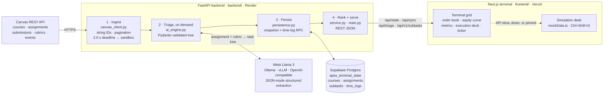

# Apex OS

**An academic execution terminal.** Apex OS reads your Canvas courses and treats coursework like a trading desk. It does four things:

- ranks open assignments by a priority score in an order book
- has Meta Llama decompose each assignment into a tree of 15–45 minute tasks
- tracks actual work against estimates
- projects final grades against your target with a what-if simulator

It has a FastAPI backend (`backend/`) and a Next.js 16 terminal (`frontend/`) laid out as a Bloomberg-style drag-and-drop grid. The whole system runs without a Canvas account, so judges can try it in under a minute.

## 60-second quickstart

You need Node.js 20.9+ (24 is tested) and either [uv](https://docs.astral.sh/uv/) or Python 3.12+. You don't need a Canvas token, model server, or database.

```bash
git clone https://github.com/FrankieBiz/MetaHackathonApex.git
cd MetaHackathonApex
./start.sh          # or: make
```

`start.sh` installs whatever is missing, starts the API on **:8000** and the terminal on **:3000**, and prints both URLs once they respond. Ctrl+C stops both. The first run spends most of its time on `npm ci` and `pip install`; later runs start in a few seconds. If a port is taken, run `API_PORT=8001 WEB_PORT=3001 ./start.sh`.

Open **http://localhost:3000**. With no Canvas token, the backend serves a deterministic sandbox: 4 courses, 12 assignments, and 10 weeks of grade history. The header badge reads `[MODE: ISOLATED SIMULATION DESK] · API`.

### Simulation Mode: `Ctrl+Shift+D`

Press **`Ctrl+Shift+D`** (Ctrl on macOS too). It is also in the `Ctrl+K` command palette. The badge switches to `· PINNED`, and the terminal runs entirely in the browser on the same fixture dataset:

- The backend is not contacted.
- Triage, checkboxes, and time logging run locally.
- Edits survive a reload.

Press it again to return to the API; that triggers a sync.

The desk also takes over automatically. If the API is slower than 2.5 s, returns an error, or isn't running, the terminal boots on the local desk (`· LOCAL`) and switches to the API when it answers. So `cd frontend && npm ci && npm run dev` alone is a working demo.

### What to try

1. **Judge Demo Tour**: Click **`▶ TOUR`** in the top bar, open with **`?tour=1`**, or select **`RUN JUDGE DEMO TOUR`** in `Ctrl+K`. In 10 seconds, it walks through priority selection, 4-stage Meta Llama triage streaming, task fill with audio feedback, and what-if sensitivity modeling.
2. **Order book** (top left). Open work is ranked by Priority Execution Score with live countdowns. Navigate using **`J`** / **`K`** or `↑` / `↓`, and jump to the top with **`G`**. The inspector displays **Grade $\Delta$** ($\partial\text{Grade}/\partial\text{Score}$), points, rubric weights, and grade floor.
3. **Execute AI triage**. Press **`T`** or click triage on an untriaged assignment. The backend streams a 4-stage grounded reasoning trace (`INGEST & AUDIT`, `CAPACITY CHECK`, `CRITICAL PATH`, `VERIFICATION`) and decomposes work into atomic 15–45 min tasks.
4. **Execution deck & audio feedback**. Press **`Shift+M`** or click **`SND ON`** to enable synthesized Web Audio feedback. Completing an atomic task sounds a crisp micro-click, and filling a deliverable triggers a harmonic chord fill and haptic vibration. Leaf tasks log time in 15-minute steps, immediately updating course **velocity** on the ticker tape.
5. **Equity curve & What-If simulator**. Drag a what-if score slider or trigger a what-if scenario. The dashed projected trajectory redraws, and the **margin of safety** badge updates between `BUFFER ABOVE TARGET` and `MARGIN DEFICIT [ WARNING ]`.
6. **Defense Council**. Switch the execution deck to **`[DEFENSE COUNCIL]`** and convene it: the Professor presses the rubric, the Student argues for the highest-return work, and the Arbitrator rules on one plan (`POST /api/v1/triage/{id}/council`, with a local council offline).
7. **Congestion alerts**. Deliverables from different courses due within 72 hours of each other carry a **`[CLUSTER]`** badge in the order book, and the Monte Carlo desk shows the variance inflation they add to the forecast.
8. **Margin call**. Press **`M`** or click **`MARGIN CALL`** for the liquidation deficit, breached courses, restoration order, and a WhatsApp preview of the alert. You can copy the text or the webhook JSON, or open WhatsApp with the draft; nothing is sent automatically.
9. **`Ctrl+K` / `?` command palette**. Fuzzy subsequence search across actions, assignments, and study sessions with shortcut badges. Drag panel headers to rearrange the Bloomberg workstation grid.

## Architecture



| Stage | What happens |
| --- | --- |
| **Canvas REST API → FastAPI** | `canvas_client.py` reads active courses (with grades and syllabi), published assignments with your submission and rubric, and upcoming events. It sends `Accept: application/json+canvas-string-ids` so 64-bit IDs never truncate. It follows `Link`-header pagination with four concurrent requests and checks each page's origin before sending the token. Results are cached for 10 minutes. Any request slower than 2.5 s, any non-200, and any malformed payload switches the snapshot to the fixtures, so the API still answers 200. |
| **FastAPI → Meta Llama structured extraction** | `POST /api/decompose` sends the assignment description and rubric to Llama through the OpenAI SDK. The call uses `response_format: json_object` at temperature 0, and the system prompt treats course content as untrusted. The reply is validated with strict Pydantic models: 1–6 root tasks, at most 8 children per node, at most 4 levels and 60 nodes, and estimates that are integers from 15 to 45 minutes. Task IDs are UUIDv5 hashes of each task's position and title, assigned on the server, so the same plan always gets the same IDs. If the model is unavailable, times out, or returns an invalid plan, a deterministic three-phase tree is used instead. |
| **FastAPI → Supabase** | After sync, triage, and every edit, the full state is upserted into `apex_terminal_state`; a cold start restores plans and progress from it. A `PATCH /api/v1/subtasks/{id}` that changes the tree (a cascade counts) also calls `apex_record_subtask_patch` over RPC. In one transaction, that function mirrors the course, assignment, and task tree into relational tables and appends a signed `time_logs` row. A Supabase outage reports `persistence_status: "unavailable"` and never fails the request. |
| **FastAPI → Next.js terminal grid** | The terminal calls `GET /api/state`, `POST /api/sync`, `POST /api/decompose`, and `PATCH /api/v1/subtasks/{id}`. Edits apply optimistically and are serialized. If the link drops, they queue and replay on reconnect. The browser computes every metric below from the current tree, so numbers react instantly and match whichever data source is active. |

## The math

The terminal implements these formulas in [`frontend/src/lib/engine.ts`](frontend/src/lib/engine.ts) and unit-tests them in `frontend/tests/engine.test.ts`. Weights are percentages of the course grade (0–100).

### Priority Execution Score

```math
P = \frac{w \times p}{\max(h,\ 1)}
```

- $w$ is the assignment weight (% of the course grade).
- $p$ is points possible.
- $h$ is hours until the deadline.

The `max(h, 1)` floor means work due within the hour, or overdue, gets the maximum urgency rather than dividing by zero or a negative number. Undated work scores 0. Completed work leaves the book, and ties go to the earlier deadline. The book tiers rows into absolute bands: **high** for $P \ge 50$, **medium** for $P \ge 10$, otherwise **low**. Absolute bands mean one overdue outlier can't demote everything else.

> A 20% assignment worth 100 points due in 40 hours scores $20 \times 100 / 40 = 50$, exactly the high-band threshold. The same assignment due in 4 hours scores 500.

The backend also returns its own `priority_score` (urgency + weight + grade risk) for API clients. The terminal does not use it.

### Completion Velocity

```math
V = \frac{\sum_{i \in C} e_i}{\max\left(\sum_{i \in C} a_i,\ 1\right)} \times 100\%
```

- $C$ is the set of completed leaf tasks with logged time.
- $e_i$ is a task's estimated minutes and $a_i$ its actual minutes.

$V > 100\%$ means you are executing faster than the Llama budget; $V < 100\%$ is a time overrun. Only leaves count, because a parent's estimate is the sum of its children. A task checked off with no logged time is left out, since with nothing to compare against it would read as infinite speed. Velocity appears portfolio-wide in the metrics panel and per course on the ticker tape.

> Three finished tasks budgeted at 30 + 30 + 30 = 90 minutes that took 25 + 20 + 30 = 75 minutes give $V = 90 / 75 = 120\%$.

### Grade Margin of Safety

```math
M = G_{\text{proj}} - T,
\qquad
G_{\text{proj}} = G + \frac{\sum_{j \in O} w_j \,(s_j - G)}{\max\left(100,\ \sum_{j \in O} w_j\right)}
```

- $G$ is the current Canvas grade (%) and $T$ the target (default 90).
- $O$ is the set of open assignments: weighted and not yet graded.
- $s_j$ is the what-if score for assignment $j$.

Unsimulated work is held at $G$, so before any slider moves $G_{\text{proj}} = G$ and $M = G - T$. Each slider shifts the projection by that assignment's weighted share. The badge shows $M$ in percentage points: `BUFFER` when $M \ge 0$, `MARGIN DEFICIT [ WARNING ]` when $M < 0$. The simulator also reports the **break-even score**, the single score on every open assignment that lands exactly on target, with $W = \sum_{j \in O} w_j$:

```math
s^{*} = G + \frac{(T - G)\,\max(100,\ W)}{W}
```

> At $G = 88$, $T = 90$, and 30 points of open weight: $M = -2$ before any what-if, and $s^{*} = 88 + 2 \times 100 / 30 \approx 94.7\%$ on the remaining work.

## Deploy: Render (API) + Vercel (terminal)

Deploy the API first, since the terminal's build needs its URL.

### 1. Backend on Render

1. In Render, choose **New → Blueprint** and select this repository. Render's GitHub app needs access if the repository is private. Render reads [`render.yaml`](render.yaml).
2. When prompted for **`CORS_ORIGINS`**, enter the terminal's Vercel URL, e.g. `https://apex-os.vercel.app`. Separate multiple values with commas and don't include a path. Localhost dev origins are always allowed. You can edit this later under **Environment**.
3. Deploy. The service builds from the repository root: `pip install -r backend/requirements.txt`, then `uvicorn backend.main:app --host 0.0.0.0 --port $PORT --workers 1`. `backend` is a package, so the module path is `backend.main`. The service is a single worker because its cache and working state live in one process. Python is pinned to 3.12 by `.python-version`, and the health check is `/openapi.json`. Only changes to `backend/` (tests excluded), `render.yaml`, or `.python-version` trigger a redeploy.
4. Copy the service URL, e.g. `https://apex-os-api.onrender.com`. Opening `<url>/api/state` should return JSON with `"demo_mode": true`.

These variables are optional. Add them under **Environment**; the full table is in [backend/README.md](backend/README.md#configuration).

| Variable | Purpose |
| --- | --- |
| `LLM_BASE_URL`, `LLM_API_KEY`, `LLM_MODEL` | Any OpenAI-compatible endpoint serving Llama 3 (Ollama, vLLM, or a hosted provider). Without one, triage returns the deterministic plan. |
| `SUPABASE_URL`, `SUPABASE_KEY` | Persistence across restarts. Apply [`backend/sql/schema.sql`](backend/sql/schema.sql) first, and use the service role key (server-side only). |
| `CANVAS_API_URL`, `CANVAS_API_TOKEN` | Live Canvas data instead of the sandbox. |

> **Keep a judging deployment in sandbox mode.** The API has no authentication. With `CANVAS_API_TOKEN` set, anyone who has the Render URL can read that student's synced grades and edit their task progress.

The free plan sleeps after 15 idle minutes, and the next request takes about a minute to wake it. During that time the terminal shows the `· LOCAL` desk. It switches to the API on its next probe, which runs about every 30 seconds while the tab is visible, or right away on **Sync now**. Open `<url>/api/state` shortly before a demo to wake it.

### 2. Terminal on Vercel

1. In Vercel, choose **Add New → Project** and import this repository, leaving **Root Directory** at the repository root. The root [`vercel.json`](vercel.json) declares `frontend/` as a Next.js [service](https://vercel.com/docs/services) (`npm ci`, `npm run build`), routes every path to it, and adds security headers. If the import screen shows a different **Framework Preset**, choose **Services**; Vercel's guide says a project builds as services only with that preset. Services are in Beta. Node comes from `engines` (24.x). A project whose **Root Directory** is already `frontend` keeps working through [`frontend/vercel.json`](frontend/vercel.json).
2. Under **Environment Variables**, add `NEXT_PUBLIC_API_URL` = your Render URL for Production (and Preview if you want previews on the API). See [`frontend/.env.example`](frontend/.env.example). The same value is the target of the terminal's same-origin proxy: [`frontend/next.config.ts`](frontend/next.config.ts) forwards `/api/v1/*` to `<NEXT_PUBLIC_API_URL>/api/v1/*` (default `http://localhost:8000`).
3. Deploy. `NEXT_PUBLIC_*` values are inlined at build time, so redeploy after changing one.
4. If the production URL differs from what you entered for `CORS_ORIGINS`, update it on Render.

On the deployed terminal, the badge should read `· API`, or `CANVAS API: CONNECTED` with a token. `· LOCAL` means the browser couldn't use the API. Either the Render service is still waking, or the browser console shows a CORS error, which means `CORS_ORIGINS` doesn't exactly match the page's origin. Preview deployments get their own URLs. They use the local desk unless you add those URLs too.

## Run pieces by hand

```bash
# Backend, from the repository root (hot reload: add --reload)
uv venv backend/.venv --python 3.12
uv pip install --python backend/.venv/bin/python -r backend/requirements.txt
backend/.venv/bin/python -m uvicorn backend.main:app --port 8000

# Terminal (NEXT_PUBLIC_API_URL defaults to http://localhost:8000)
cd frontend && npm ci && npm run dev
```

For live Canvas locally, export `CANVAS_API_URL` and `CANVAS_API_TOKEN` before `./start.sh`. [backend/README.md](backend/README.md#configuration) shows how to read the token without echoing it. A local Llama is `ollama pull llama3`; the backend's default `LLM_BASE_URL` already points at Ollama.

## Verify

```bash
make check
```

This runs `ruff check`, `ruff format --check`, and `pytest` for the backend, then lint, typecheck, unit tests, and a production build for the frontend. Backend tests mock Canvas, Llama, and Supabase over HTTPX transports and never need credentials. GitHub Actions ([`.github/workflows/verify.yml`](.github/workflows/verify.yml)) runs the same checks inside `backend/` and `frontend/` on every push and pull request, plus `npm audit` of the frontend's production dependencies.

## Repository map

```text
backend/              FastAPI service: Canvas client, Llama planner, Supabase persistence (backend/README.md)
frontend/             Next.js 16 terminal: React 19, Tailwind 4, react-grid-layout, Recharts, Zustand (frontend/README.md)
render.yaml           Render Blueprint for the API
vercel.json           Vercel config: builds frontend/ as a Next.js service from the repository root
frontend/vercel.json  Vercel settings for a project whose Root Directory is frontend
start.sh, Makefile    One-command local stack and checks
legacy_archive/       Original Vite + Express workspace that predates the terminal (docs/legacy-vite-app.md)
```

## Meta inference telemetry

Set server-only `META_API_KEY` to enable Meta Model API. `META_BASE_URL` defaults to `https://api.meta.ai/v1`; `META_MODEL` defaults to `muse-spark-1.3` and also accepts `Llama-3.3-70B-Instruct`, `Llama-3.1-8B-Instruct`, a Llama 4 model, `muse-wonder`, or any other model ID served by your endpoint. Model availability depends on the deployment; configure an endpoint serving the requested version. Meta's [compatibility configuration example](https://dev.meta.ai/llama/resources/cookbook/documentlens) documents the base URL. Existing `LLM_*` settings continue to work without a Meta key.

`POST /api/decompose` (also `/decompose`) accepts `{ "assignment_id": "..." }` and returns `subtasks`, `source`, and `telemetry: { model_used, latency_ms, prompt_tokens, completion_tokens, tokens_per_sec }`. Throughput is completion tokens divided by full API round-trip seconds, including request and prefill latency. Unreported usage is `null` and appears as `—`; local starter plans and saved plans are explicitly labeled rather than presented as model inference. Measurements stay in browser memory and are excluded from persisted course and task data. The legacy triage route keeps its array response for existing clients.

## Agentic triage trace

`POST /api/decompose` also returns `agent_reasoning_trace`, four steps of `{ step, title, status, summary, evidence, engine, latency_ms }`, where `status` is `pass`, `watch`, or `risk`:

| Step | What it computes | Engine |
| --- | --- | --- |
| `[01 // INGEST & AUDIT]` | Rubric constraints, the deliverable's weight, and its grade floor: the lowest score that keeps the course on target with other work held at the current grade. A floor of 85% or more is a HIGH risk weight. | `AUDITOR_MODEL` (e.g. `deepseek-flash`) when `AUDITOR_API_KEY` is set and it answers; otherwise the rubric parser |
| `[02 // CAPACITY CHECK]` | Course Margin of Safety, Open Budget (estimated minutes still open on other active work), and the share of the time left before the deadline that work due earlier already needs | `capacity-engine` |
| `[03 // CRITICAL PATH]` | The primary model's plan as a sequence of atomic 15–45 minute tasks, with the model's one-line sequencing note | `META_MODEL`, or `local-starter-plan` / `cached-plan` |
| `[04 // VERIFICATION]` | The plan re-priced at the student's historical Completion Velocity, and the deadline load and slack that result | `velocity-auditor` |

Steps 01 and 02 run first and their findings are sent to the primary model as an `agent_brief`. Every figure in the trace (floors, margins, budgets, loads, velocity) is computed by the server from terminal state; the only model-written text is the labeled `MODEL NOTE` line and, when the pre-filter answers, its `RUBRIC` constraints. The execution deck streams the four steps with live latency before revealing the tree, and the order book inspector keeps them as the selected deliverable's agent brief. With the backend offline, the terminal's local planner produces the same trace in the browser (`reasoningTrace` in `frontend/src/lib/engine.ts`).

For judging, select an assignment in the Order Book, move its highlighted 0–100% what-if slider, and watch the projected grade and Margin of Safety update. Then execute triage with a configured Meta endpoint to populate the header badge with real model throughput and latency. Tests mock inference; live Meta validation requires your own credentials. The original TypeScript implementation is preserved under `legacy_archive/`.
